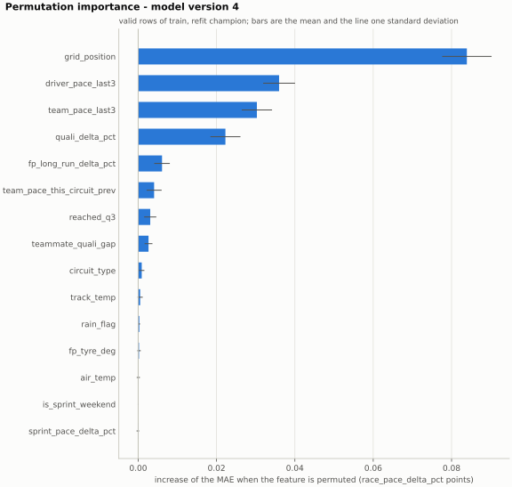
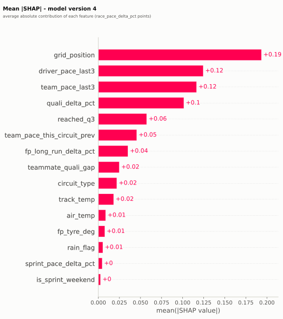
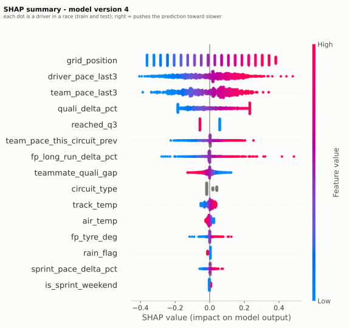
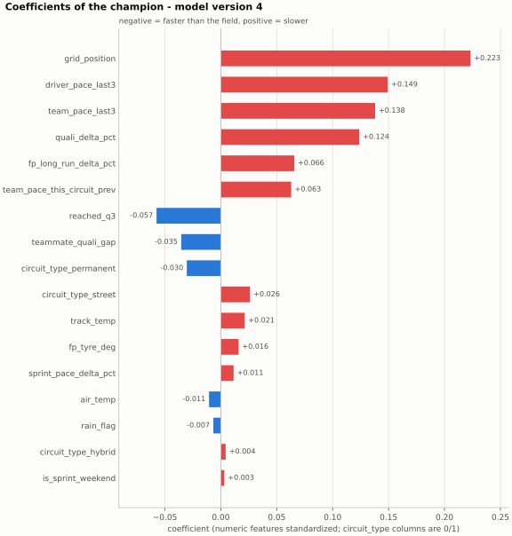
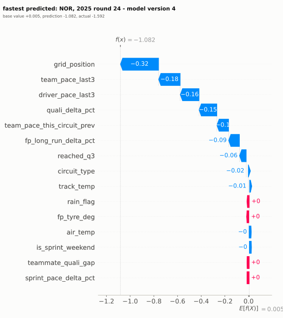
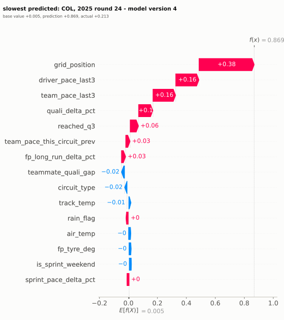
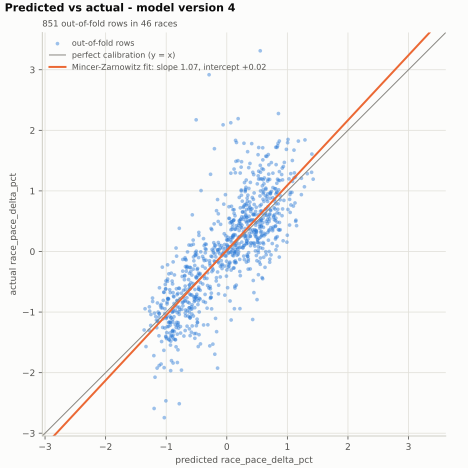
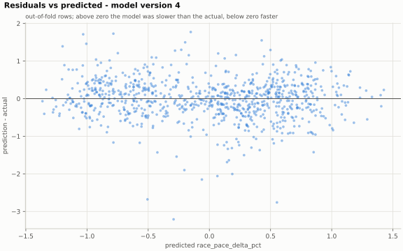

# Model card: f1-race-pace, version 4 (ridge)

2026-11-02 · explain run d5bb2da8b777423eb46c949c88b44739 · evaluate run 100bba09a6604cf895095eb3143b4e30 · sampling run e64c04d8897c44d283da0422f2e818ce

## 1. What it predicts

After Saturday qualifying, the model predicts the race pace of each driver for Sunday, `race_pace_delta_pct`: the median clean lap of the driver relative to the median clean lap of the field, in percent. A negative value means faster than the field and a positive one means slower.

The model estimates, after Saturday qualifying, how much faster or slower each driver will be than the field on
Sunday's clean laps. It is meant to read the expected pace of each driver and the order of the grid, not to name a
winner or a podium. The test result in part one shows how much it improves on the qualifying baseline, and where.

It is a personal MLOps project that runs locally. It is not a betting tool and it is not tuned for one.

### Test result

Scored once on 259 valid rows of 14 test races, against the qualifying baseline (a linear regression on the qualifying gap). Each value is followed by its 95% bootstrap interval over races. Lower is better for MAE and RMSE; higher is better for R² and pairwise accuracy.

| Metric | ridge | Baseline |
| --- | --- | --- |
| MAE | 0.429 [0.362, 0.507] | 0.554 [0.482, 0.641] |
| RMSE | 0.553 [0.469, 0.648] | 0.688 [0.604, 0.775] |
| R² | 0.500 [0.355, 0.616] | 0.227 [0.030, 0.372] |
| Pairwise accuracy | 0.759 [0.709, 0.804] | 0.740 [0.700, 0.781] |

## 2. What weighs most

Importance describes how this model uses each feature, not how much the feature matters for racing: correlated features share their importance, and a feature that looks unimportant here can still matter in the world. Permutation importance is the increase in MAE on the training rows when the feature is shuffled, so it is optimistic compared with held-out data. Mean |SHAP| is the average size of the feature's contribution to the prediction.

| Feature | Permutation importance (MAE increase, mean ± std) | Mean abs SHAP |
| --- | --- | --- |
| `grid_position` | +0.084 ± 0.006 | 0.194 |
| `driver_pace_last3` | +0.036 ± 0.004 | 0.125 |
| `team_pace_last3` | +0.030 ± 0.004 | 0.117 |
| `quali_delta_pct` | +0.022 ± 0.004 | 0.102 |
| `fp_long_run_delta_pct` | +0.006 ± 0.002 | 0.035 |
| `team_pace_this_circuit_prev` | +0.004 ± 0.002 | 0.046 |
| `reached_q3` | +0.003 ± 0.002 | 0.057 |
| `teammate_quali_gap` | +0.003 ± 0.001 | 0.025 |
| `circuit_type` | +0.001 ± 0.001 | 0.022 |
| `track_temp` | +0.001 ± 0.001 | 0.018 |
| `rain_flag` | +0.000 ± 0.000 | 0.005 |
| `fp_tyre_deg` | +0.000 ± 0.000 | 0.008 |
| `air_temp` | +0.000 ± 0.000 | 0.009 |
| `is_sprint_weekend` | +0.000 ± 0.000 | 0.003 |
| `sprint_pace_delta_pct` | +0.000 ± 0.000 | 0.005 |

The model is linear, so its coefficients are shown as well (numeric features are standardized; categories are one-hot columns).

| Column | Coefficient |
| --- | --- |
| `grid_position` | +0.223 |
| `driver_pace_last3` | +0.149 |
| `team_pace_last3` | +0.138 |
| `quali_delta_pct` | +0.124 |
| `fp_long_run_delta_pct` | +0.066 |
| `team_pace_this_circuit_prev` | +0.063 |
| `reached_q3` | -0.057 |
| `teammate_quali_gap` | -0.035 |
| `circuit_type_permanent` | -0.030 |
| `circuit_type_street` | +0.026 |
| `track_temp` | +0.021 |
| `fp_tyre_deg` | +0.016 |
| `sprint_pace_delta_pct` | +0.011 |
| `air_temp` | -0.011 |
| `rain_flag` | -0.007 |
| `circuit_type_hybrid` | +0.004 |
| `is_sprint_weekend` | +0.003 |

## 3. A concrete case

The two cases are the driver predicted fastest and the driver predicted slowest in the most recent test race. They are the extremes of the prediction, not the cases where the model fails, and their error is shown as it is. The prediction is the base value plus the contributions of the features.

### Predicted fastest

NOR, 2025 round 24. Prediction -1.082, actual -1.592, error +0.509 (prediction minus actual). Base value +0.005.

| Feature | Contribution |
| --- | --- |
| `grid_position` | -0.323 |
| `team_pace_last3` | -0.183 |
| `driver_pace_last3` | -0.159 |
| `quali_delta_pct` | -0.150 |
| `team_pace_this_circuit_prev` | -0.099 |

### Predicted slowest

COL, 2025 round 24. Prediction +0.869, actual +0.213, error +0.656 (prediction minus actual). Base value +0.005.

| Feature | Contribution |
| --- | --- |
| `grid_position` | +0.382 |
| `driver_pace_last3` | +0.161 |
| `team_pace_last3` | +0.157 |
| `quali_delta_pct` | +0.099 |
| `reached_q3` | +0.058 |

## 4. Where it fails

### Calibration

On 851 out-of-fold rows of 46 races, the actual value is +0.020 + 1.074 × predicted (Mincer-Zarnowitz line). A slope of one and an intercept of zero would be a perfectly calibrated model. These rows are fewer than the training races because the cross-validation always trains on the earliest races first, and only the races after that first window are ever predicted out of fold.

### Errors by segment

These errors come from the out-of-fold predictions of cross-validation on the training races, not from the test races: the test result is the one in the test result section above. Bias is the mean of prediction minus actual, so a positive bias means predicted slower than it was. No interval is computed per segment, so the differences between close segments are not significant.

#### By team

| Segment | Rows | Races | MAE | Baseline MAE | Bias | Note |
| --- | --- | --- | --- | --- | --- | --- |
| Ferrari | 90 | 46 | 0.482 | 0.533 | +0.049 |  |
| Red Bull Racing | 85 | 46 | 0.423 | 0.532 | +0.056 |  |
| Mercedes | 89 | 46 | 0.418 | 0.478 | +0.009 |  |
| Williams | 77 | 45 | 0.410 | 0.534 | -0.122 |  |
| McLaren | 89 | 46 | 0.403 | 0.560 | +0.150 |  |
| Alpine | 79 | 45 | 0.397 | 0.518 | -0.065 |  |
| Kick Sauber | 87 | 46 | 0.393 | 0.598 | -0.096 |  |
| RB | 84 | 46 | 0.376 | 0.509 | -0.124 |  |
| Haas F1 Team | 87 | 45 | 0.357 | 0.482 | -0.002 |  |
| Aston Martin | 84 | 46 | 0.352 | 0.398 | -0.073 |  |

#### By circuit type

| Segment | Rows | Races | MAE | Baseline MAE | Bias | Note |
| --- | --- | --- | --- | --- | --- | --- |
| street | 163 | 9 | 0.480 | 0.581 | -0.123 |  |
| hybrid | 109 | 6 | 0.469 | 0.568 | -0.016 |  |
| permanent | 579 | 31 | 0.367 | 0.486 | +0.010 |  |

### Known limitations

- It only knows what is true at the end of Saturday. Weather changes, strategy, first-lap incidents, safety cars and
  mechanical failures on Sunday are invisible to it. The target removes the laps under a neutralisation, but the
  race that follows them is still shaped by them.
- Out-of-fold errors by team and by circuit type come from cross-validation on the training races, not from the test
  races or from a future season. Segments with few rows are marked, and no interval is computed for a segment, so
  small differences between close segments should not be read as real.
- Importance and SHAP values describe what this model uses, not what matters in racing: correlated features share
  their importance, and a feature that looks unimportant can still matter in the world.
- The two cases shown are the extremes of the prediction, the driver predicted fastest and the one predicted
  slowest, not the cases where the model fails the most.
- The data starts with the first season OpenF1 serves, so the model has seen a small number of seasons and circuits.

### 2026 regulations

The training data comes from seasons before the 2026 technical regulations. A change of that size can reshuffle the
order of the teams and change what qualifying pace says about race pace, so the relations learned here may not hold.
There is no data from the new regulations in training and the effect is not measured in this card; it is measured
later, in the walk-forward backtest over the 2026 season. Until then, treat predictions for 2026 with extra caution.

## 5. Data and versions

### Data and split

- Source: OpenF1, seasons 2023 to 2025.
- Split: chronological by race, with 20% of the races in test. Train has 56 races (2023 round 1 to 2025 round 10) and test has 14 (2025 round 11 to 2025 round 24).
- Cross-validation: 5 temporal folds inside train.
- Feature set: v1. The model was trained through 2025 round 10.

### Model

- Algorithm: ridge.
- Hyperparameters (best Optuna trial):
  - `alpha`: 98.47
  - `imputation`: median
- Tuning budget: 50 trials, seed 42, 5 folds.

### How it was chosen

The candidate was picked on the out-of-fold errors of train, never on test: the simplest model not significantly worse than the best one. Reference: elasticnet. Candidate: ridge. It beats the qualifying baseline on the out-of-fold errors.

| Model | CV MAE | Difference to reference | Interval | Not worse |
| --- | --- | --- | --- | --- |
| ridge | 0.402 | +0.004 | [-0.002, 0.009] | yes |
| elasticnet | 0.398 | +0.000 | [0.000, 0.000] | yes |
| random_forest | 0.405 | +0.008 | [-0.002, 0.017] | yes |
| lightgbm | 0.403 | +0.005 | [-0.007, 0.016] | yes |
| xgboost | 0.406 | +0.008 | [-0.002, 0.018] | yes |
| catboost | 0.398 | +0.000 | [-0.014, 0.013] | yes |

### Versions

- Model version: 4 (MLflow version 4), promoted 2026-11-01.
- Sampling run: e64c04d8897c44d283da0422f2e818ce.
- Explain run: d5bb2da8b777423eb46c949c88b44739.
- Evaluate run: 100bba09a6604cf895095eb3143b4e30.
- Generated: 2026-11-02.
