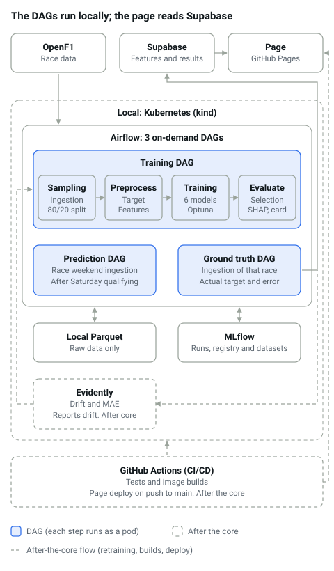

# F1 race pace MLOps

Predicts, after Saturday qualifying, how fast each F1 driver will be in Sunday's race (`race_pace_delta_pct`: the driver's median clean-lap pace against the field's, in %), and publishes the results on a free static page. Everything is open source and runs locally: Airflow on kind, MLflow, Supabase for the calculated tables and GitHub Pages for the page.



## Status

Phase 0 (setup) in progress. The scope and data model are written (the backlog is kept locally); the repo layout, dependencies, config loader, Supabase schema and local stack exist. There is an exploratory notebook with a first baseline (`notebooks/baseline_linear_regression.ipynb`).

## Setup

```
uv sync                         # Python 3.12 environment from uv.lock
uv run pytest                   # tests
cp .env.example .env            # then fill in the values
```

MLflow and Airflow run in a kind cluster, see "Kubernetes cluster" below (`docker-compose.yml` is kept only as a stopped backup of the old MLflow data).

Supabase: create a project, open the SQL editor, run `supabase/migrations/0001_schema.sql`, and copy the URL, anon key and service key into `.env`. The service key never goes in the repository.

## Pipeline images

The pipeline steps run from two images built from one Dockerfile (`docker/pipeline/Dockerfile`). The step is the command and the entrypoint is `python`, so the same image runs any of its steps. Both run as a non-root user (uid 1000), and neither holds `.env`, data or secrets.

| Image | Steps | Size |
| --- | --- | --- |
| `f1-pipeline-data:0.1.0` | `ingest`, `load_reference`, `load_features`, `ground_truth`, `next_race` | 537 MB |
| `f1-pipeline-ml:0.1.0` | `sample`, `train`, `evaluate`, `explain`, `model_card`, `predict`, `backtest` | 1.82 GB |

`data` has only `[project].dependencies`; `ml` adds the group `ml` of `pyproject.toml` (scikit-learn, xgboost, lightgbm, catboost, optuna, mlflow, shap, ...). Both install from `uv.lock`, so they match the local environment.

```
docker build -f docker/pipeline/Dockerfile --target data -t f1-pipeline-data:0.1.0 .
docker build -f docker/pipeline/Dockerfile --target ml -t f1-pipeline-ml:0.1.0 .
```

Always pass `--target`: without it Docker builds the last stage, and a later stage added to the Dockerfile would end up under the wrong tag.

> The `docker run` checks of this section were written for the compose MLflow. MLflow now lives in the cluster, so a step that needs it runs as a pod with `k8s/run-step.sh` (see below); the two `docker run` examples only apply if you start the old compose stack again.

What a container needs is the same one a pod will need in kind:

| What | Where | `docker run` |
| --- | --- | --- |
| Raw and split Parquets | `/app/data` | `-v "$(pwd)/data:/app/data"` |
| `SUPABASE_URL`, `SUPABASE_SERVICE_KEY` | environment | `--env-file .env` |
| `MLFLOW_TRACKING_URI` (`ml` only) | environment | `-e MLFLOW_TRACKING_URI=http://mlflow:5000` |

The `.env` has `MLFLOW_TRACKING_URI=http://localhost:5001`, which only works from the host; inside a container `-e` overrides it with the service name, reached through the compose network (`docker-kubernetes-ml_default`, named after this folder; `docker network ls` shows it). Start the stack first with `docker compose up -d`.

Checks, with the stack running:

```
# data: rewrite the ground truth of one race already on disk (same values; only dag_run_id changes)
docker run --rm --network docker-kubernetes-ml_default -v "$(pwd)/data:/app/data" --env-file .env \
  f1-pipeline-data:0.1.0 scripts/ground_truth.py --year 2026 --round 20

# ml: load the current champion the way `predict` does (reads MLflow and Supabase, writes nothing); prints e.g. `4 ridge Pipeline`
docker run --rm --network docker-kubernetes-ml_default --env-file .env -e MLFLOW_TRACKING_URI=http://mlflow:5000 \
  f1-pipeline-ml:0.1.0 -c "import sys, xgboost, lightgbm, catboost; sys.path.insert(0, 'src'); from training.explain import load_champion; c = load_champion(); print(c.model_version_id, c.algorithm, type(c.model).__name__)"
```

The champion is loaded with `load_champion` (`runs:/<run>/model`), not with `models:/f1-race-pace@champion`: that URI does not resolve for this registry, not even from the host. `sys.path.insert` is needed because the stored model pickles classes from `src/training/`; the scripts do the same.

Steps that write outside `/app/data` (`explain` writes `site/charts/`, `model_card` writes `MODEL_CARD.md`) lose those files when the container ends. In the cluster the DAG `explain_champion` writes them inside `/app/data/outputs/` and `k8s/fetch-outputs.sh` brings them back (see the training and explain routines below).

## Kubernetes cluster

A single-node kind cluster `f1` (namespace `f1`) runs PostgreSQL, MLflow and Airflow 3.x. The pipeline steps run as pods that mount the Parquets from a shared volume. Everything is plain manifests applied with `kubectl apply -k k8s`, except Airflow, which is the official Helm chart (pinned, `k8s/airflow/values.yaml`).

Needs Docker Desktop with at least 10 GB of memory (`docker info --format '{{.MemTotal}}'`), plus `kind`, `kubectl` and `helm`. All the commands run from the repository root. Versions are pinned in `k8s/kind-config.yaml` (node image) and `k8s/airflow/values.yaml` (chart 1.22.0, Airflow 3.2.2).

**1. Create the cluster and the namespace**

```
kind create cluster --name f1 --config k8s/kind-config.yaml
kubectl apply -k k8s            # namespace, volumes, PostgreSQL, MLflow, pod permissions, DAGs
```

PostgreSQL and MLflow stay waiting until the Secrets of step 4 exist; they start by themselves afterwards.

**2. Build the images and load them into the node.** The node has its own image store, so every image is loaded with `kind load`. The pods use fixed tags and `imagePullPolicy: IfNotPresent`: after rebuilding an image **load it again**, or the pods keep running the old one with no warning.

```
docker build -f docker/pipeline/Dockerfile --target data -t f1-pipeline-data:0.1.0 .
docker build -f docker/pipeline/Dockerfile --target ml -t f1-pipeline-ml:0.1.0 .
docker build -t f1-mlflow:3.17.1 docker/mlflow
kind load docker-image f1-pipeline-data:0.1.0 --name f1
kind load docker-image f1-pipeline-ml:0.1.0 --name f1
kind load docker-image f1-mlflow:3.17.1 --name f1
```

**3. Copy the Parquets once** (the cluster owns them afterwards; the host `data/` stays as the source to copy again):

```
kubectl apply -f k8s/data-loader.yaml
kubectl wait -n f1 --for=condition=Ready pod/data-loader
kubectl cp data/. f1/data-loader:/app/data
kubectl delete -f k8s/data-loader.yaml
```

**4. Create the Secrets** from the host `.env` (it reads `.env`, never writes a value to a file; an existing Secret is left untouched, so the random Airflow passwords are generated once):

```
k8s/create-secrets.sh
```

It creates `supabase` (URL and service key), `postgres` (the MLflow database variables plus the Airflow database and admin passwords) and `airflow-metadata` (the connection string of the Airflow database). The anon key never enters the cluster.

**5. Migrate MLflow from docker-compose** (once; it copies the database and the artifacts, so the `champion` alias and the run ids that Supabase points to keep existing; the compose volumes are only read and stay as a backup):

```
docker compose up -d mlflow-db      # only the database; the compose MLflow server must stay stopped
k8s/migrate-from-compose.sh         # refuses to run over a cluster database that already has runs, unless --force
docker compose stop mlflow-db
```

**6. Install Airflow** (the node downloads the `apache/airflow` image, over 1 GB):

```
helm install airflow apache-airflow/airflow --version 1.22.0 -n f1 -f k8s/airflow/values.yaml --timeout 10m
```

**Daily use**

```
# a pipeline step as a pod: logs streamed, pod deleted, exit code of the container
k8s/run-step.sh data scripts/ground_truth.py --year 2026 --round 20
k8s/run-step.sh ml scripts/promote.py --help

kubectl port-forward -n f1 svc/mlflow 5001:5000                 # MLflow UI at http://localhost:5001
kubectl port-forward -n f1 svc/airflow-api-server 8080:8080     # Airflow UI at http://localhost:8080, user `admin`
kubectl get secret postgres -n f1 -o jsonpath='{.data.AIRFLOW_ADMIN_PASSWORD}' | base64 --decode | pbcopy   # admin password to the clipboard

kubectl apply -k k8s                # after changing a DAG in dags/: a changed file is read in about a minute, a new file can take about five; no restart
kubectl exec -n f1 airflow-scheduler-0 -c scheduler -- airflow dags list                # the DAGs Airflow has loaded
kubectl exec -n f1 airflow-scheduler-0 -c scheduler -- airflow dags list-import-errors  # `No data found` when every DAG file imports
k8s/fetch-outputs.sh                # after `explain_champion`: copies the charts and the model card from the cluster volume to site/charts/ and MODEL_CARD.md (never commits)
helm upgrade airflow apache-airflow/airflow --version 1.22.0 -n f1 -f k8s/airflow/values.yaml --timeout 10m   # after changing k8s/airflow/values.yaml (restarts the Airflow pods)
```

The DAG `smoke_pod` (trigger it from the UI) launches one pod of each image and is the quick check that the cluster, the permissions and the images work.

**Weekly routine** (the DAGs `prediction` and `ground_truth` have no schedule: trigger them by hand from the Airflow UI)

| When | Do | Params |
| --- | --- | --- |
| After Saturday qualifying (`Q` published by OpenF1, about 30 minutes after it ends) | Trigger `prediction` | leave `year` and `round` empty: it resolves the next race |
| After the race (about 30 minutes after it ends) | Trigger `ground_truth` | leave `year` and `round` empty: it resolves the last race held |
| Then | `uv run python scripts/publish.py` by hand | |

Both DAGs have two tasks: `resolve_race` (pod of the `data` image running `scripts/next_race.py`, which prints the race as JSON) and the step itself, which takes `year` and `round` from it. To run for another race, give **both** `year` and `round`; one alone fails in `resolve_race`. Both DAGs have no retries: a failed task with a `STOPPED:` line in its log means something has to change first. A live OpenF1 session blocks the schedule too (trigger again 30 minutes after it ends), and a race already predicted stops `prediction` on purpose (a prediction is never replaced).

`next` is the first race of the year whose race session has not started, so after the lights go out on Sunday `prediction` points to the following round. To predict a race that already started, trigger it with its `year` and `round`; the prediction is stored as late (`is_late`).

The same resolution by hand, as pods:

```
k8s/run-step.sh data scripts/next_race.py --which next    # the race `prediction` would run for
k8s/run-step.sh data scripts/next_race.py --which last    # the race `ground_truth` would run for
k8s/run-step.sh data scripts/next_race.py --which next --year 2026 --round 20   # checks that the race exists
```

**Training and explain routines** (the DAGs `training` and `explain_champion` have no schedule: trigger them by hand from the Airflow UI)

| When | Do | Params |
| --- | --- | --- |
| To try one or two models | Trigger `training` | `models` = comma-separated config keys, e.g. `ridge,elasticnet`: it samples, trains only those and skips `evaluate` (about 5 minutes for those two) |
| New races, or a new configuration worth the test | Trigger `training` | `models` empty: the six models in series and then `evaluate` (about 18 minutes) |
| A retraining as of a race (walk-forward) | Trigger `training` | `cutoff` = `YYYY-R`, e.g. `2026-10` (the races through that round); empty uses the range of `config/training.json`. Combine with `models` to check it quickly |
| The candidate is worth it | `uv run python scripts/promote.py <model_version_id>` by hand | the version of `f1-race-pace` that `evaluate` picked (MLflow UI); needs the MLflow port-forward above |
| After promoting | Trigger `explain_champion`, then `k8s/fetch-outputs.sh` | no params |
| Then | Review `git diff` and commit `site/charts/` and `MODEL_CARD.md` by hand | |

`training` has these tasks: `choose_models` and `check_cutoff` (they check the names in `models` and the format of `cutoff` before anything runs, so a wrong key or a badly written cutoff fails at once), `sample_arguments` and `sample` (a new sampling run, the thread of the training; with a `cutoff` it uses the races through that round), `train` (one pod per model, one at a time; the first one also runs the baseline and the floor) and, only when `models` is empty, `evaluate`. Every run starts with its own sampling run, and `evaluate` scores the test once for it, so every full run is one use of the test: run it when there are new races or a configuration worth it, and use `models` for everything else. The DAG never promotes: the `champion` alias changes only with `scripts/promote.py`. There are no retries: a failed task with a `STOPPED:` line means something has to change first, and a live OpenF1 session blocks `sample` (trigger again 30 minutes after it ends).

`explain_champion` runs `explain` and then `model_card` on the current champion, and writes the charts and the card in `/app/data/outputs/` of the cluster volume (`explain` also upserts `shap_values`). `k8s/fetch-outputs.sh` replaces `site/charts/` and `MODEL_CARD.md` in the repository with them, refuses if there is nothing on the volume yet, and never commits.

The `cutoff` is `YYYY-R` (year and round, e.g. `2026-10`) and it is checked twice: `check_cutoff` rejects a bad format in seconds, and `sample` stops with `STOPPED:` if that round does not exist or has not been held yet (it would otherwise train on everything held). It is the same option as `scripts/sample.py --cutoff`. Every run still has its own sampling run and promotes nothing. Two things to keep in mind: the split is still 80/20 by race over the races up to the cutoff, so with a cutoff in the middle of 2026 **no 2026 race is in the train** (the most recent 20% is test; the final refit on all the races is SPEC 23); and the test MAE of two runs with different cutoffs cannot be compared, because their tests are different races.

After changing a script in `src/` or `scripts/` (or `docs/model_card_notes.md`, which the `ml` image bakes in), rebuild the `ml` image, load it again with `kind load docker-image f1-pipeline-ml:0.1.0 --name f1` and run `docker image prune`; the pods keep running the old image otherwise.

**Rebuild from scratch**

```
helm uninstall airflow -n f1
kind delete cluster --name f1
```

`kind delete cluster` **loses the volumes**: the Parquets, the MLflow runs created after the migration and the Airflow history. The host `data/` and the compose volumes `docker-kubernetes-ml_mlflow_db` and `docker-kubernetes-ml_mlflow_artifacts` are the only copies that survive, so do not delete them. The Docker Desktop disk is shared with the node: the `ml` image exists twice (Docker and the node), and a full disk shows up as pods that never start or as databases that crash with `No space left on device`.

## Where to look

| File | What it holds |
| --- | --- |
| [`docs/definition_scope_architecture.md`](docs/definition_scope_architecture.md) | Scope, frozen contracts, features, architecture, phases (English, canonical) |
| [`docs/data_model.md`](docs/data_model.md) | Supabase tables, RLS and the entity-relationship diagram |
| [`DECISIONS.md`](DECISIONS.md) | Every decision, one line each; the single source |

## Repository layout

```
diagrams/    architecture and ERD (ERD source: erd.dot, regenerate with dot -Tsvg)
docs/        scope, data model and backlog
notebooks/   exploration (the FastF1 cache is gitignored)
src/        code root: features, ingestion, training, common
dags/ tests/ site/ scripts/
config/     training.json
supabase/   migrations/0001_schema.sql
docker/     MLflow image and the pipeline images (docker/pipeline); docker-compose.yml at the root (stopped backup)
k8s/        kind cluster, PostgreSQL, MLflow, Airflow values and the scripts that drive them
```
