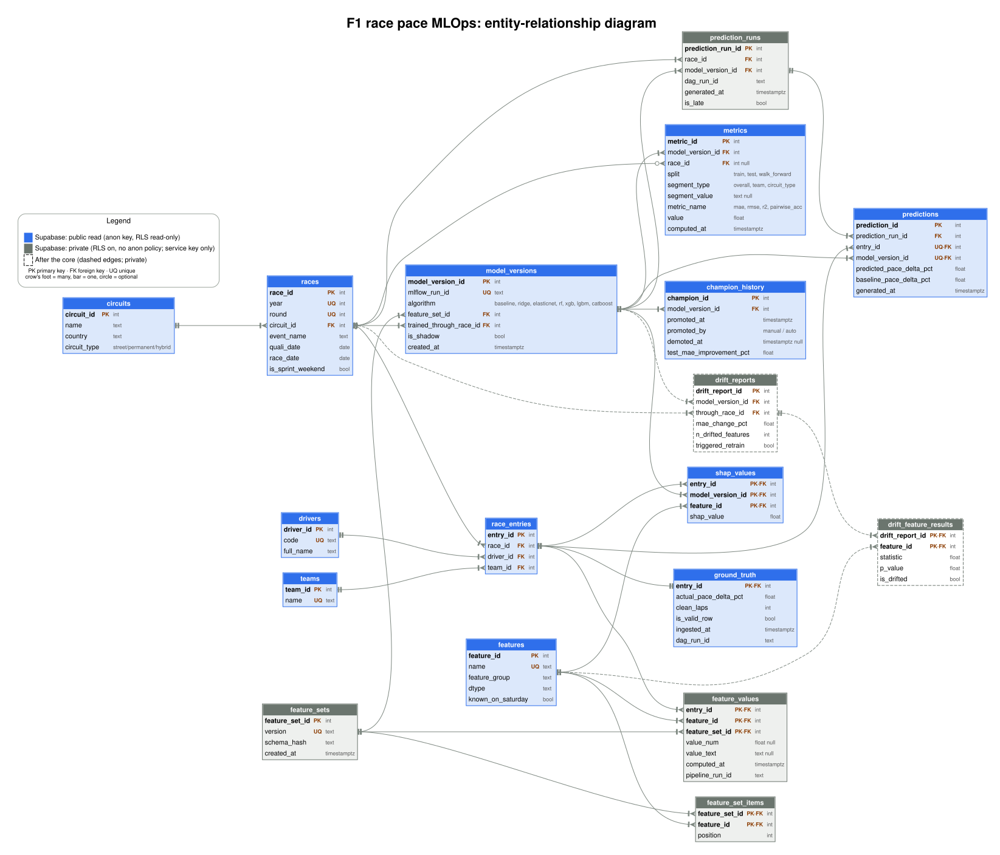

# F1 race pace MLOps: data model

_Companion to `definition_scope_architecture.md`. Diagram sources: `diagrams/erd.dot` (Graphviz) rendered to `diagrams/erd.svg` and `diagrams/erd.png`._



To regenerate: `dot -Tsvg diagrams/erd.dot -o diagrams/erd.svg`.

## Design principles

1. **One grain: `race_entries`.** The project's row is "one driver in one race". Every fact (features, prediction, actual result, SHAP) hangs from `entry_id`, so joins are always the same and a row can never be duplicated across tables.
2. **Features in long format.** Features are stored as `(entry_id, feature_id, feature_set_id, value)` instead of one column per feature. If retraining adds, removes or renames a feature, only rows in `features` and `feature_set_items` change; no `ALTER TABLE`, and old model versions can still be reproduced.
3. **Predictions and ground truth are separate.** The prediction DAG writes `predictions` on Saturday; the ground truth DAG writes `ground_truth` after the race. Neither touches the other's table, and the actual value is stored once per entry, no matter how many model versions predicted it.
4. **Everything is versioned.** Each prediction points to a `model_version`, and each model version points to the `feature_set` it was trained with.
5. **Leakage guard in data.** `features.known_on_saturday` marks what is allowed as a feature; the automated leakage test can read it.

## Tables

### Reference

| Table | Key | Purpose |
| --- | --- | --- |
| `circuits` | `circuit_id` | Track and `circuit_type` (street, permanent, hybrid), loaded from `circuits.yml`. |
| `drivers` | `driver_id` | Driver identity (`code` is unique, e.g. `VER`). |
| `teams` | `team_id` | Team identity. |
| `races` | `race_id`, unique `(year, round)` | One Grand Prix, with its circuit, dates and `is_sprint_weekend`. |
| `race_entries` | `entry_id`, unique `(race_id, driver_id)` | A driver in a race with the team they drove for that weekend (drivers change teams, so team is not on `drivers`). This is the project's row. |

### Feature store

| Table | Key | Purpose |
| --- | --- | --- |
| `features` | `feature_id` | Catalog that mirrors `features.yml`: name, group (qualifying, practice, sprint, form, circuit, weather, context), dtype and `known_on_saturday`. |
| `feature_sets` | `feature_set_id` | A named version (`v1`, `v2`...) of the list of features a model uses, with a `schema_hash` of the Pandera schema. |
| `feature_set_items` | `(feature_set_id, feature_id)` | Which features belong to a set and in what `position`, so the wide matrix is rebuilt in the order the model expects. |
| `feature_values` | `(entry_id, feature_id, feature_set_id)` | The values. `value_num` holds numbers and flags (0/1), `value_text` holds categories such as `circuit_type`. A missing value (for example FP2 on a sprint weekend) is stored as NULL or simply no row; imputation stays inside each model's pipeline, as the contract says. |

Why `feature_set_id` on the value and not `model_version_id`: the baseline, the 6 models and the shadow model train on the same features, so values are computed once and shared. A new model version only needs a different `feature_set_id` when the feature list actually changes. The cost is that a feature recomputed with different logic needs a new feature set version too (the `schema_hash` and `computed_at` help detect that).

Write rule: `feature_values` is written with an upsert on `(entry_id, feature_id, feature_set_id)`, so rerunning preprocess is idempotent. Changing the logic of a feature means a new feature set version (`v2`) with a new `schema_hash`, never an overwrite of `v1`.

Typed columns (`value_num`/`value_text`) avoid casting everything to text. The trade-off of long format is more rows (about 1,800 entries × 15 features ≈ 27,000 per set, which is tiny here) and a pivot step before training.

### Models

| Table | Key | Purpose |
| --- | --- | --- |
| `model_versions` | `model_version_id` | One trained model: MLflow run, algorithm (baseline, ridge, elasticnet, rf, xgb, lgbm, catboost), `feature_set_id`, `trained_through_race_id` (walk-forward cutoff: only races before it were used) and `is_shadow` for the model without 2026. |
| `champion_history` | `champion_id` | Every promotion of the `champion` alias with `promoted_at`, `demoted_at`, `promoted_by` (`manual` for the first champion, `auto` after a retraining) and the test MAE improvement that justified it (rule for `auto`: at least 2%, sustained over the last 5 races). The current champion is the row with `demoted_at IS NULL`. |

### Predictions and ground truth

| Table | Key | Purpose |
| --- | --- | --- |
| `prediction_runs` | `prediction_run_id` | One execution of the prediction DAG for a race and a model version: `dag_run_id`, `generated_at` and `is_late` (generated after the race started, so the page can flag it). |
| `predictions` | `prediction_id`, unique `(entry_id, model_version_id)` | Predicted `race_pace_delta_pct` per driver, plus the qualifying baseline prediction for the same entry (`baseline_pace_delta_pct`) so the comparison is available without another join. The unique pair is the contract key `(entry_id, model_version_id)`, since `entry_id` already encodes year, round and driver. |
| `ground_truth` | `entry_id` | Actual `race_pace_delta_pct`, `clean_laps` and `is_valid_row`, ingested after the race using the same target function in `src/features/`. One row per entry, independent of model versions. |

The page reads a view that joins both. Predictions are made on Saturday for every entry, but only rows with `ground_truth.is_valid_row = true` count for metrics (a driver with fewer than 10 clean laps has no reliable actual); the page still shows the prediction for the rest. Metric queries filter on `is_valid_row`:

```sql
CREATE VIEW prediction_results AS
SELECT r.year, r.round, d.code AS driver, t.name AS team,
       p.model_version_id,
       p.predicted_pace_delta_pct,
       g.actual_pace_delta_pct,
       p.predicted_pace_delta_pct - g.actual_pace_delta_pct       AS error,
       abs(p.predicted_pace_delta_pct - g.actual_pace_delta_pct)  AS abs_error,
       g.is_valid_row,
       pr.is_late
FROM predictions p
JOIN prediction_runs pr USING (prediction_run_id)
JOIN race_entries e     USING (entry_id)
JOIN races r            USING (race_id)
JOIN drivers d          USING (driver_id)
JOIN teams t            ON t.team_id = e.team_id
LEFT JOIN ground_truth g USING (entry_id);   -- NULL until the race result is ingested
```

### Evaluation and explanation

| Table | Key | Purpose |
| --- | --- | --- |
| `metrics` | `metric_id` | Long format as well: one row per `(model_version, split, race, segment, metric_name)`. `split` is train, test or walk_forward; `segment_type` is overall, team or circuit_type (with `segment_value`); `race_id` is NULL for aggregates. New metrics need no schema change. |
| `shap_values` | `(entry_id, model_version_id, feature_id)` | SHAP contribution per feature, only for the champion. It feeds the "concrete case" section of the model card. Global importance can be aggregated from here. |

### After the core (dashed in the diagram)

| Table | Key | Purpose |
| --- | --- | --- |
| `drift_reports` | `drift_report_id` | Evidently run every 3 races: MAE change, number of drifted features and whether it triggered retraining (MAE up 15% or drift in 3+ features). |
| `drift_feature_results` | `(drift_report_id, feature_id)` | Per-feature drift statistic, p-value and flag. |

## Retraining example

1. Training DAG finds `fp_tyre_deg` is useless in 2026 and adds `tyre_age_mean` instead.
2. It inserts the new row in `features`, creates `feature_sets` `v2`, and lists the 15 items in `feature_set_items`.
3. It computes values for `v2` only for the new feature (the unchanged ones can be copied or recomputed).
4. It registers new `model_versions` with `feature_set_id = v2`.
5. If one beats the champion by the promotion rule, `scripts/promote.py` promotes it automatically: a row is added to `champion_history` with `promoted_by = auto` and the previous one gets `demoted_at`. The first champion is promoted by hand.
6. Old predictions keep pointing to the old model version and feature set, so history is never rewritten.

Pivot from long to wide for training or prediction:

```sql
SELECT fv.entry_id,
       max(fv.value_num) FILTER (WHERE f.name = 'quali_delta_pct')       AS quali_delta_pct,
       max(fv.value_num) FILTER (WHERE f.name = 'grid_position')         AS grid_position
       -- ... one line per feature in feature_set_items
FROM feature_values fv
JOIN features f USING (feature_id)
WHERE fv.feature_set_id = :feature_set_id
GROUP BY fv.entry_id;
```

In practice the DAG does this in pandas: read the long table, `pivot(index="entry_id", columns="name", values="value_num")`, and reorder columns by `feature_set_items.position`.

## What history is stored

Everything calculated is stored in Supabase and training reads it from there, so history from all seasons is kept:

| Data | Table | Coverage |
| --- | --- | --- |
| Features | `feature_values` | Every driver-race row from 2023 to the latest race, for each feature set. About 1,400 entries × 15 features ≈ 21,000 rows per set. |
| Actual result (the target) | `ground_truth` | Every race from 2023 to the latest, including every season used for train and test. |
| Race, driver and team identity | `races`, `race_entries`, `drivers`, `teams` | All years. |
| Predictions | `predictions` | The 2026 backtest plus live predictions from 2027 (and any late-2026 race predicted live). |
| Metrics and models | `metrics`, `model_versions` | Train, test and per-race results. |

Raw data (laps, sessions, weather) stays in local Parquet. It is only needed to calculate features and targets: for a new race, and for all races when a new feature set is created. Historical rows must be calculated with the same function used for new races (`src/features/`), so the model trains on data built exactly like the data it will see.

## Where tables live

Every table of this model lives in **Supabase**; there is no second relational database. What stays outside is not in the diagram: raw OpenF1 data (local Parquet, used only to calculate features and targets) and the MLflow runs, artifacts and `champion` alias (local). There is no second copy of the features in Parquet.

Access is controlled with Row Level Security (RLS). RLS is enabled on every table; the difference is whether a policy exists for the `anon` key, the one the page uses in the browser. The `service_role` key used by the DAGs bypasses RLS, lives only on the local machine and never goes in the repository.

| Access | Tables | RLS setup |
| --- | --- | --- |
| Public read (blue in the diagram) | `circuits`, `drivers`, `teams`, `races`, `race_entries`, `features`, `model_versions`, `champion_history`, `predictions`, `ground_truth`, `metrics`, `shap_values`, view `prediction_results` | `ENABLE ROW LEVEL SECURITY` + a `SELECT` policy `TO anon USING (true)`. No insert, update or delete policy. |
| Private (gray in the diagram) | `feature_sets`, `feature_set_items`, `feature_values`, `prediction_runs`, `drift_reports`, `drift_feature_results` | `ENABLE ROW LEVEL SECURITY` and **no policy**: `anon` gets nothing. Only the service key reads or writes them. |

```sql
ALTER TABLE feature_values ENABLE ROW LEVEL SECURITY;          -- private: no policy

ALTER TABLE predictions ENABLE ROW LEVEL SECURITY;             -- public read
CREATE POLICY "public read" ON predictions FOR SELECT TO anon USING (true);
```

Model performance metrics (`metrics`: MAE, RMSE, R², pairwise accuracy) are public and shown on the page. Monitoring data (`drift_reports`, `drift_feature_results`) is internal only: it is reviewed locally with Evidently reports and never shown on the page.

Two details:

- **`prediction_results` joins a private table.** The view uses `prediction_runs` (for `is_late`), which `anon` cannot read. Create the view with its default owner permissions (not `security_invoker`) and run `GRANT SELECT ON prediction_results TO anon`. The view then exposes only the columns it selects, and `prediction_runs` stays closed. Alternative: copy `is_late` into `predictions` and drop that join.
- **Optional extra layer.** If you want private tables not to be reachable through the API at all, put them in a separate schema (for example `internal`) that is not in Supabase's exposed schemas. RLS without policies is enough for this project; the schema split only adds defense in depth.

Foreign keys are real everywhere, including `predictions.prediction_run_id`, because all tables share one database. The `snapshot.json` fallback should contain the public-read tables the page uses. Remember that Supabase pauses the project after a week without use, which now also blocks training and the DAGs until it is reactivated.

## Decisions

All decisions, including the ones that shaped this model, are recorded in [`../DECISIONS.md`](../DECISIONS.md).
