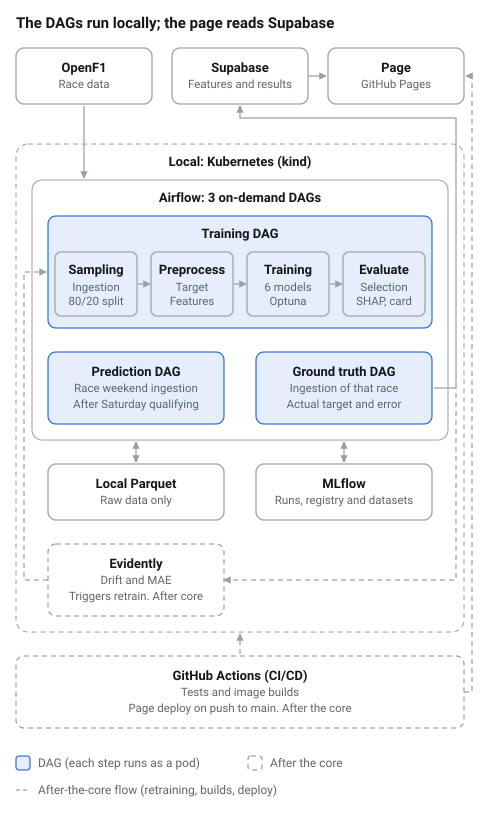

# F1 race pace MLOps: scope and architecture

_Last updated: 2026-10-15_

## Summary and decisions

The project predicts, after Saturday qualifying, how fast each F1 driver will be in Sunday's race, and publishes the results on a free static page. Everything is open source and runs locally.

Closed decisions:

- Orchestration: Airflow with `KubernetesPodOperator` on kind (machine with 16 GB or more).
- Three DAGs: training, prediction (every Saturday after qualifying) and ground truth (after each race), run on demand from the local machine. No API: FastAPI is an optional extra.
- Data: seasons 2023 to 2027 from OpenF1 (free; it has no 2022 data), with raw data in local Parquet and everything calculated (features, target, predictions, metrics) in Supabase. Chronological 80/20 train/test split by race (no separate validation set; model selection uses temporal cross-validation inside train) and walk-forward retraining in 2026, with a shadow model without 2026 for comparison. With about 6 races of 2026 left on 2026-10-15, 2026 is a backtest and live predictions start with 2027 (the last 2026 races live only if the pipeline is ready in time).
- Evidently, retraining trigger and GitHub Actions: after the core.
- Zero cost: public repository and GitHub Pages for the page.
- Out of scope: Kubeflow, MinIO, Prometheus/Grafana, Helm, cloud and betting.

## Frozen contracts

These contracts do not change without first recording it in `DECISIONS.md`.

| Contract | Definition |
| --- | --- |
| Row | One driver in one race, with data up to the end of Saturday (sprint included on sprint weekends) |
| Target | `race_pace_delta_pct` (next section) |
| Target function | Lives in `src/features/`; used by historical training and the ground truth DAG, with no second implementation |
| Valid rows | A row is dropped without qualifying or with fewer than 15 clean laps; that rule lives in features, not in the models. Predictions are made for every entry, but metrics count only rows with `is_valid_row = true` |
| Missing values | Imputation of practice, sprint and form features lives inside each model's pipeline, as an Optuna hyperparameter |
| Metric | MAE as the main one, always compared against the qualifying baseline: a linear regression of the target on `quali_delta_pct`, fitted on train |
| Split | Chronological 80/20 by race: the oldest 80% of races is train, the most recent 20% is test (all rows of a race stay together). No validation set: models and Optuna trials are compared with temporal cross-validation inside train; test is touched only once, to report the final metric. The split is defined in the config and applied by the `sampling` step of the training DAG; later steps read it and nobody redefines it. The first model trains on 2023–2025 (80/20 inside that range), so test stays out of the 2026 regulations; 2026 is walk-forward from round 1 and the shadow is the first model, frozen. Each retraining takes every race available up to its cutoff and applies the same 80/20; only races prior to the one being predicted are included |
| Data between steps | Raw data in local Parquet, written by the `sampling` step and registered in MLflow as train and test datasets (path, digest, rows and races); calculated features and results in Supabase tables with a fixed Pandera schema. Training reads features from Supabase, with no second copy in Parquet |
| Champion | `champion` alias in the MLflow registry. The first champion is promoted by hand after reviewing the evaluation. After a retraining it is promoted automatically, only if test MAE improves by 2% or more and that improvement holds over the last 5 races. The challenger's mean MAE over the last 5 races must be at most 0.98 × the champion's on the same races and not worse in at least 3 of the 5. Promotion is a local script (`scripts/promote.py`), not part of training or evaluation, and never runs in GitHub Actions. The prediction DAG loads only that alias |
| Output | The `predictions` table in Supabase, with key `(entry_id, model_version)` (an entry is one driver in one race). The prediction DAG inserts the predicted pace; the ground truth DAG inserts the actual value in `ground_truth`, and the error is derived in the `prediction_results` view. See `data_model.md` |
| Public read | The page queries Supabase from the browser with the anonymous key and read-only RLS policies; a JSON snapshot in the repository serves as a fallback |
| Forbidden | Using any Sunday data as a feature |

## Target and features

The target `race_pace_delta_pct` is the driver's pace against the field's in the same race, in %: negative means faster than the field and positive, slower. Because it is compared within the same race, the circuit stops mattering.

```
target = (median of the driver's clean laps / median of the field's clean laps - 1) * 100
```

A clean lap excludes lap 1, pit in and out laps, and laps under safety car or yellow flag. A driver with fewer than 15 clean laps is dropped (the field's median still pools drivers with at least 10).

Identification columns (they do not predict): `year`, `round`, `circuit`, `driver`, `team`. Features, all known on Saturday:

| Feature | Group | What it measures |
| --- | --- | --- |
| `quali_delta_pct` | Qualifying | Best qualifying lap vs pole, in % |
| `grid_position` | Qualifying | Qualifying position (ignores grid penalties; the race grid is Sunday data) |
| `reached_q3` | Qualifying | 1 if the driver reached Q3 |
| `fp_long_run_delta_pct` | Practice | Long-run pace in FP2 vs the field (NaN on sprint weekends) |
| `fp_tyre_deg` | Practice | Seconds each lap rises during the long run |
| `driver_pace_last3` | Recent form | Average target of the driver over the 3 previous races |
| `team_pace_last3` | Recent form | Same, at team level |
| `teammate_quali_gap` | Recent form | Qualifying gap to the teammate |
| `team_pace_this_circuit_prev` | Circuit | Team pace at that circuit the previous year |
| `circuit_type` | Circuit | Street, permanent or hybrid |
| `track_temp`, `air_temp` | Weather | Session temperatures |
| `rain_flag` | Weather | 1 if it rained |
| `sprint_pace_delta_pct` | Sprint | Median clean lap in the sprint vs the field, in % (NaN on normal weekends) |
| `is_sprint_weekend` | Context | 1 if it is a sprint weekend |

Feature definitions (initial; the EDA can tune them, and any change goes in `DECISIONS.md`):

- **Clean lap:** lap number above 1, not a pit-out lap, no pit stop in the lap, a recorded lap time, and no safety car, virtual safety car, red flag or track-wide yellow during the lap. The intervals come from OpenF1 `race_control`: one opens at the flag or the "DEPLOYED" message and closes at the next track-scope `CLEAR` or `GREEN`; sector yellows do not count. The field is the pooled clean laps of drivers with at least 10 of them. Wet races get no special treatment.
- **Qualifying:** `quali_delta_pct` is capped at 3%, because rain or red flags create gaps up to ~15% that models cannot extrapolate.
- **Practice:** a long run is at least 5 consecutive clean laps on one compound in FP2, ignoring laps slower than 107% of the stint best. `fp_tyre_deg` is the slope of lap time over lap number in the longest long run. No fuel correction.
- **Sprint weekends:** there is no FP2, so the sprint replaces it: `sprint_pace_delta_pct` uses the same formula as the target. The FP2 features come in empty (NaN) and each model's pipeline fills them.
- **Weather:** from the qualifying session, since there is no forecast of Sunday: means of `track_temp` and `air_temp`, and `rain_flag` is 1 if it rained at any point.
- **Form:** `driver_pace_last3` and `team_pace_last3` use the previous 3 valid races and cross seasons, but not the 2025→2026 regulation change, so the first 2026 races come in empty. `teammate_quali_gap` compares this qualifying with the teammate's, in %.
- **Circuit:** `circuit_type` comes from a `circuits.yml` in the repository (street, permanent, hybrid). `team_pace_this_circuit_prev` is NaN for a circuit not raced the previous year and for all 2026 rows. `regulation_era` is not included, because it is constant in training from 2023 onward.

## Scope by stage

The core includes the static page and the champion explanation, because they are part of the portfolio deliverable.

| Stage | Includes |
| --- | --- |
| Core | Ingestion with Pandera; short EDA; preprocessing (features, target and valid-row rule); qualifying baseline and 6 models (Ridge, ElasticNet, Random Forest, XGBoost, LightGBM, CatBoost) with Optuna; evaluation (candidate selection, SHAP and model card); first champion promoted by hand; three DAGs (training, prediction and ground truth); `predictions` table; artifacts and static page. First as scripts in docker-compose, then on Kubernetes with Airflow |
| After the core | Evidently (drift and MAE, internal only) with retraining trigger; walk-forward retraining of 2026; GitHub Actions for tests, image builds and page deployment; promotion by a local script (manual for the first champion, automatic after a retraining). Optional extra: FastAPI to practice Deployment, Service and Ingress |
| Out of scope | Kubeflow, MinIO, Prometheus/Grafana, Helm, cloud deployment and betting (kept as an extension: teammate duels) |

Changes from what was discussed: SHAP enters the scope, only for the champion, because the page's explanation section needs it; and FastAPI leaves the core, because predictions are batch and the page is static.

## Architecture



The whole pipeline runs locally and the three DAGs are triggered by hand: training whenever you want, prediction after qualifying and ground truth after the race. Raw data stays in local Parquet, and MLflow holds the runs, the registered datasets and the `champion` alias. The training DAG has four steps: sampling (ingestion and split), preprocess, training and evaluate. Everything calculated goes to Supabase: the features (all history, which training reads from there), the actual results, the predictions and the metrics. The page reads the public tables in the browser with no need to deploy; the internal ones (features, drift) are private through RLS.

### Runtime topology

- **Docker Compose (phases 0–7):** MLflow with a PostgreSQL backend store (a container, separate from Supabase, which holds only project tables) and artifacts on a persistent volume. The pipeline runs as scripts that read `.env`.
- **kind (phase 8):** MLflow moves into the cluster, Airflow 3.x runs from its official image, and the pipeline steps run as pods from a separate pipeline image. All pods share one PVC for Parquets and artifacts. The Supabase service key is a Kubernetes Secret; images are loaded with `kind load docker-image`.
- **MLflow registry:** one registered model `f1-race-pace`, one version per run (the baseline included, tagged with its algorithm) and the `champion` alias on one version.
- **Prediction DAG:** it creates `races` and `race_entries` for a new race, runs any missing earlier ground truth (the form features need it) and predicts with the champion and the shadow, each under its own `model_version_id`.
- **Evidently:** last task of the ground truth DAG, run once 3 races have been ingested since the last report. If the rule holds, it triggers the training DAG through Airflow's REST API with the race cutoff.
- **Tooling:** Python 3.12 and uv.

## Static page and artifacts

The page is deployed once and then updates itself: it queries Supabase from the browser every time someone opens it, so a new prediction appears without deploying again. What does require a push is changing the model's explanation or charts, which are files and only change on retraining. Every row and every artifact carries the `run_id`, the model version and the generation date, so versions never get mixed. A `publish` script copies the `.svg` charts and `MODEL_CARD.md` into `site/` and writes `snapshot.json`; the commit and push stay manual. `MODEL_CARD.md` is generated from a Jinja2 template plus a hand-written notes file.

| Artifact | Contains | Where it lives |
| --- | --- | --- |
| `predictions` and `ground_truth` tables | Predicted pace and actual pace by driver and race; the `prediction_results` view derives the error by model version | Supabase, read by the page |
| `metrics` table | Error and effectiveness, by split and by race | Supabase, read by the page |
| `snapshot.json` | Copy of both tables at the last run; fallback if Supabase is paused | Repository |
| `features.yml` | Feature catalog; also generates the Pandera schema | Repository |
| `circuits.yml` | Circuit type per track | Repository |
| `MODEL_CARD.md` | Text of the model explanation | Repository and page |
| `.svg` files | Charts for SHAP, permutation importance, residuals and predicted vs actual | Repository and page |

Metrics that get published:

- MAE and RMSE in percentage points, compared against the qualifying baseline.
- R² and MAE improvement over the baseline, in %.
- Pairwise ordering accuracy: percentage of driver pairs in a race whose pace order the model gets right (50% equals chance).
- Error per 2026 race, by team and by circuit type.

The explanation section comes from `MODEL_CARD.md` and has five parts: what it predicts and what it is for; what weighs most (global SHAP and permutation importance of the champion); a concrete case (SHAP of one driver in the most recent race); where it fails (errors by circuit and team, effect of the 2026 regulations); and the model card (data, split, model and FastF1 versions). SHAP is computed only for the champion; if the champion is linear (Ridge or ElasticNet), its coefficients are used instead.

After each qualifying session, the prediction DAG inserts that race's prediction into Supabase; after the race, the ground truth DAG inserts the actual result, and the error is derived in the `prediction_results` view. The page reflects both changes instantly. If a prediction is generated after the race, the generation date gives it away and the page marks it as late.

To avoid depending on a site generator, the page is built with Jinja2 and Python's Markdown library. MkDocs Material, the usual option, has [committed support for 12 months from November 2025](https://github.com/squidfunk/mkdocs-material/issues/8523), and its successor Zensical is recommended once it has the features you depend on. GitHub Pages is free on public repositories, with [limits](https://docs.github.com/en/pages/getting-started-with-github-pages/github-pages-limits) of 1 GB per site and 10 minutes per deployment, more than enough for this project.

## Phases and definition of done

The core is phases 1 to 8; phase 9 comes after. A phase does not start until the previous one is met. `backlog.md` breaks each phase into tasks.

1. **Ingestion**: done when one idempotent ingestion function (shared by the sampling step and the prediction and ground truth DAGs) downloads seasons 2023–2027 from OpenF1 to local Parquet, session coverage is at least 95% and there is a report of the missing races.
2. **EDA**: done when the target, missing values, correlations and the qualifying baseline have been reviewed on the train portion only, and any resulting decision is in `DECISIONS.md`. It is a manual notebook and does not run in the DAGs.
3. **Sampling and preprocess**: done when the sampling step ingests, splits chronologically and registers the train and test Parquets in MLflow, there is one row per driver and race, the Pandera schema passes, a test confirms no feature uses Sunday data, the target function is tested against known races, the valid-row rule drops anyone without qualifying or 15 clean laps, and the features of all seasons are loaded in Supabase.
4. **Training**: done when the baseline and the 6 models have their runs logged in MLflow, reading features from Supabase, with temporal split, imputation inside the pipeline and comparable MAE. Training does not promote anything.
5. **Evaluate**: done when the best candidate is selected against the baseline and its SHAP charts and `MODEL_CARD.md` exist. If no model beats the baseline, the page says so. The first champion is then promoted by hand.
6. **Prediction and ground truth DAGs**: done when, as scripts in docker-compose, the backtest of 2026 runs race by race using only data up to each Saturday and fills `predictions` (champion and shadow), the ground truth DAG inserts the actual pace into `ground_truth`, and one race is predicted live (a late-2026 race if the pipeline is ready, otherwise the first of 2027). Both call the feature function from phase 3.
7. **Page**: done when the script generates `site/` with results, features, predicted vs actual and the explanation, and it renders locally.
8. **Kubernetes and Airflow**: done when the three DAGs run end to end on kind, with one pod per step and per model, and the prediction DAG takes year and round as parameters.
9. **After the core**: done when Evidently detects drift in the 2026 backtest or in 2027 and triggers the training DAG, a push to `main` deploys the page with GitHub Actions, and the local promotion script exists (manual for the first champion, automatic after a retraining). FastAPI, if wanted, goes here as an extra.

## Risks and mitigations

The biggest risk is getting stuck because of the data or a tool that changes, so every row aims to avoid that.

| Risk | Mitigation |
| --- | --- |
| OpenF1 ingestion fails halfway, or a session is not published yet (OpenF1 restricts access during a session and for about 30 minutes after it) | Retries with backoff, one folder per session with `meta.json` written last, and a coverage check with Pandera that lists what is missing |
| Qualifying or race data takes time to become available after the session | The DAGs retry with backoff and run on demand |
| Supabase pauses the project after a week without use and the page is left without data | The page falls back to `snapshot.json` in the repository when the query fails; between seasons the project is reactivated by hand |
| The Supabase anonymous key is exposed in the page | Read-only RLS policies; the service key lives only on the local machine, outside the repository |
| In 2026 F1 does not publish active aerodynamics or ERS data, and DRS comes in empty | No feature uses them |
| The 2026 regulations change how the cars behave | Walk-forward retraining and a shadow model without 2026 for comparison |
| A row uses Sunday data (leakage) | Automated test and form features computed only from previous races |
| Few rows (around 1,400) | Simple models, temporal cross-validation inside train in Optuna and an honest report against the baseline |
| OpenF1 changes or stops receiving data (it depends on F1's feed, which now requires a paid subscription for the archive) | All history is saved to local Parquet, so training does not depend on the service; the first live check is the Austin 2026 qualifying |
| Tools that stop being maintained (MkDocs Material, MinIO) | They are not used: Jinja2 for the page and a persistent volume for the artifacts |
| The 2026 season ends before the pipeline is ready | 2026 becomes a walk-forward backtest and live predictions start with 2027 |
| Low RAM with Airflow, MLflow and kind at once | 16 GB minimum; if that fails, native Kubernetes Jobs and CronJobs instead of Airflow |

## Change rule

Before touching code, every change of contract, scope or tool is recorded in [`DECISIONS.md`](../DECISIONS.md) with one line: date, what changed and why. That file is the single source; this document and `data_model.md` link to it.
