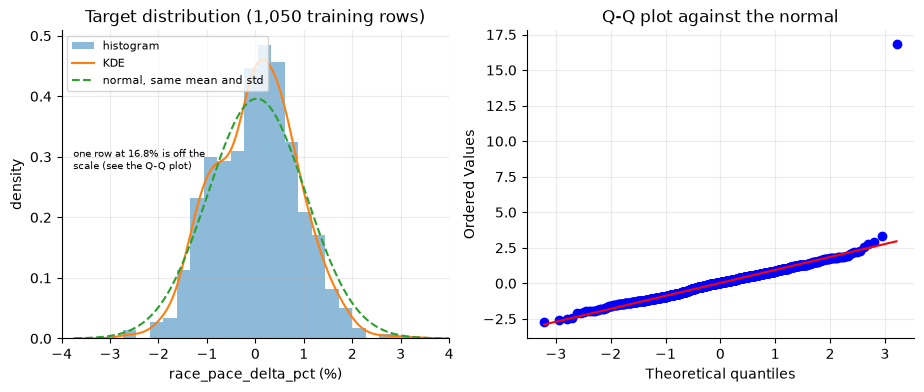
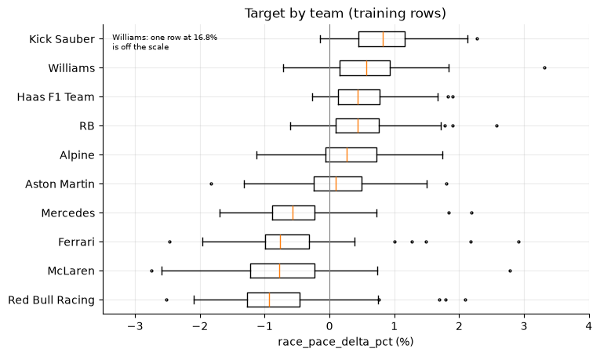
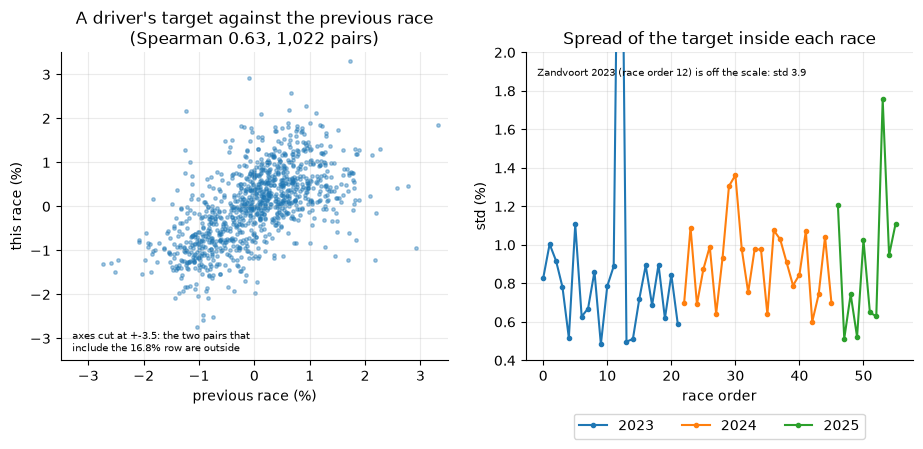
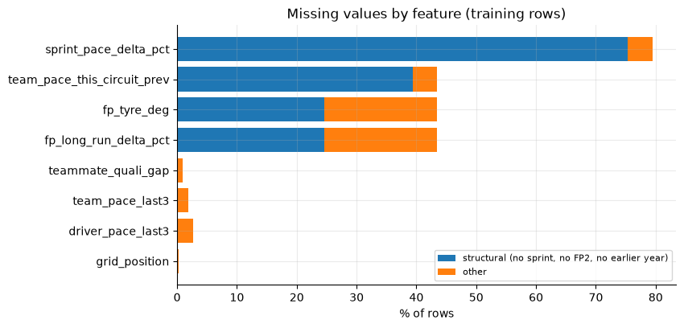
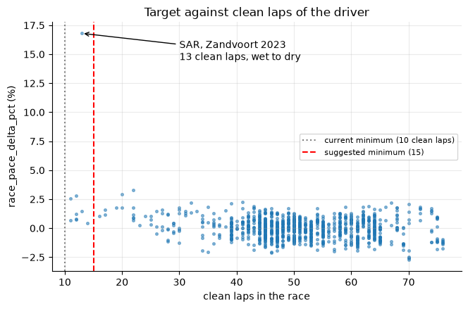
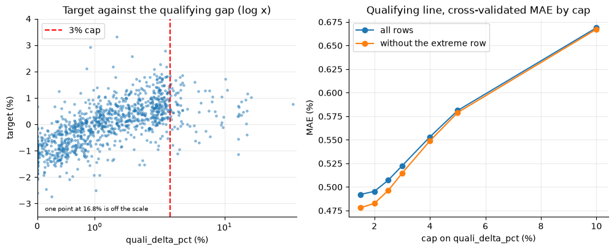
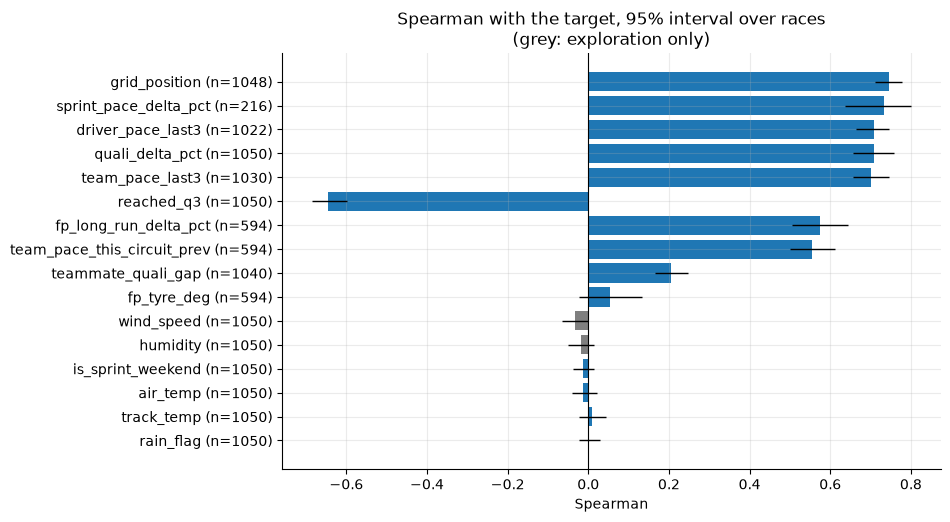
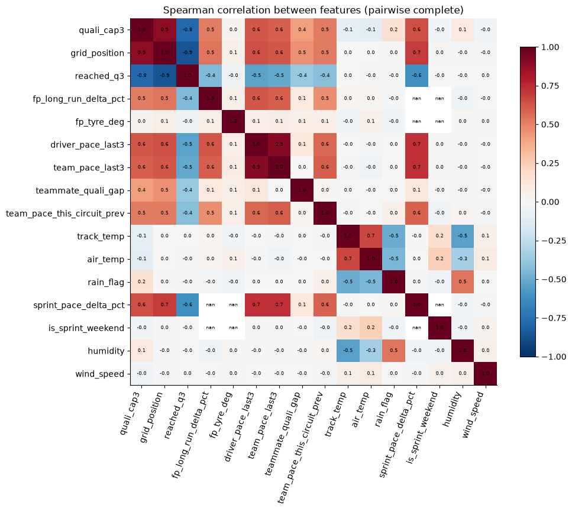
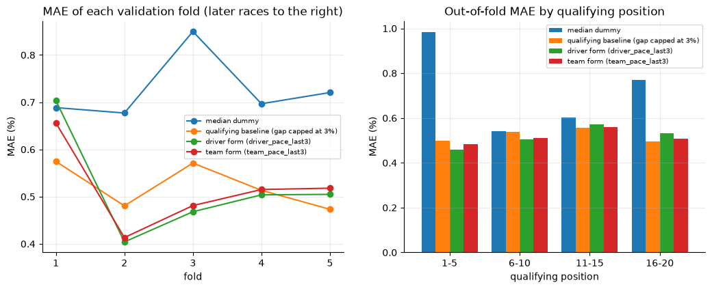

# EDA summary (phase 2, SPEC 03)

What the exploratory notebooks in `notebooks/exploratory/` found, with the figures that matter and the decisions they suggest. The notebooks hold every number and the code; `DECISIONS.md` stays the single source of decisions.

## 1. Data and method

The EDA looks at the **train races only**: the first 56 of the 70 races held in 2023–2025, ordered by `(year, round)` (`split.test_fraction` 0.2 of `config/training.json`): 2023 rounds 1–22 (Imola was cancelled), 2024 rounds 1–24 and 2025 rounds 1–10. The test races and 2026 were never opened. The dataset is provisional (`notebooks/exploratory/provisional.py`, deleted in phase 3): one row per driver in each of those races, 1,118 rows and 25 columns, of which 1,050 are valid (a qualifying time and at least 10 clean laps) and 68 are kept with an empty target; the target of 2024 round 8 matches an independent recomputation for all 20 drivers. Rows of one race share weather, safety cars and strategy, so every interval resamples whole races (1,000 or fewer draws, seed 42) and every model check uses five expanding folds over whole races in order (`cv.folds`), scoring MAE on valid rows only. Because the target here is a throwaway copy and the train set stops at 2025 round 10, phase 3 has to run the real function on the same races and reopen any conclusion that moves; year effects cover 2023, 2024 and half of 2025 only.

## 2. Results

### Target

The target is symmetric and has a single mode, with no clipping and no zero spike. The long tail in the Q-Q plot is **one row**: SAR at Zandvoort 2023 (+16.8%, 13 clean laps, a wet-to-dry race). With it the skew is 4.4 and the excess kurtosis 71.9; without it, 0.02 and -0.01, and RMSE/MAE is 1.25, the value of a normal target. So the target needs no transform; it needs that row dealt with (decision 1).

The team is the main structure: medians run from -0.93 (Red Bull) to +0.82 (Kick Sauber), and inside a team the spread is 0.47–0.77. Circuit type and year barely change the spread. This is why a qualifying-based line already captures most of what is predictable, and why per-team error is worth reporting in phase 6.

A driver's pace repeats: Spearman 0.63 against their previous race (Pearson 0.45, interval 0.34–0.62, 1,022 pairs), 0.57 for a team. The spread of the target inside a race shows no trend or seasonality (ACF within ±0.26 at every lag), so the chronological order matters for the split, not as a feature. It is the evidence for the form features.

### Missing values and rows

Most missing values are **by design**, not random: no sprint on normal weekends (79% of rows), no FP2 on sprint weekends, no earlier year for 2023. The part that is not structural is small: a driver's or team's first race, and, for FP2, the 25% of normal-weekend rows where a wet or red-flagged session left no long run (Suzuka 2024 and 2025 have none for any driver). The empty values carry almost no information about the target on their own. This sets the imputation per column (section 4).

Drivers with 10 to 14 clean laps are noisy: 9 rows, a target std of 5.2, and 3 of them beyond ±2% against 1% among drivers with 40 laps or more. From 15 laps on the spread is the same as for the rest. A minimum of 15 costs 9 rows (0.9%), removes the extreme row without looking at the label, and takes the excess kurtosis from 71.9 to -0.07 (decision 1).

The target rises with the qualifying gap and then flattens beyond about 2–3%; the large gaps are wet or red-flagged qualifyings (85 rows above 3%, 58 with rain). Capping the gap at 3% takes the cross-validated MAE of the qualifying line from 0.682 to 0.523 (0.671 to 0.515 without the extreme row). A lower cap does slightly better (2%: 0.495), inside the spread over folds (0.04–0.06), so the cap is a Phase 4 candidate to tune.

### Relations

The signal sits in the Saturday and form features: `grid_position` 0.745, `sprint_pace_delta_pct` 0.734 (216 sprint-weekend rows only), `driver_pace_last3` 0.709, `quali_delta_pct` 0.708, `team_pace_last3` 0.701, `reached_q3` -0.645. Weather, `rain_flag`, `is_sprint_weekend` and `fp_tyre_deg` are flat, with intervals that include 0, and so are the two exploration-only columns. Rain does weaken the qualifying relation (0.58 with rain in Q, 0.76 without), but a straight line cannot use that. No feature is a leakage suspect (every source is known by Saturday; the form features match an independent recomputation from earlier races).

The features overlap in two blocks: the form of the driver and of the team (0.91) and the qualifying block (capped gap, grid position and Q3, 0.78–0.90). VIF on complete cases peaks at 8.6 (`grid_position`), none above 10 for the core set. Ridge and ElasticNet cope with it; for trees and SHAP the importance splits inside each block, so read it by family.

### Baseline

The floor (median dummy) scores a cross-validated MAE of 0.727; the qualifying line on the capped gap 0.523 ± 0.043; and predicting `driver_pace_last3` as it is, with no model, 0.517 ± 0.100. The two references win in different places: form is better in folds 2 and 3, the qualifying line in folds 1 and 5, and the line earns its gain at the front and the back of the grid while at positions 6–10 it barely beats the floor (0.54 against 0.54). The estimated noise floor is 0.23–0.40, so 0.12–0.29 is the room left for the models.

## 3. Decisions

The lines in `DECISIONS.md` were added on 2026-10-22, after this summary was reviewed. Decision 1 changed a frozen contract of `CLAUDE.md` (the valid-row rule): it was chosen on 2026-10-22, when SPEC 04 was designed, and the minimum is now 15 clean laps.

| # | Decision | Supporting figure or number | Line in `DECISIONS.md` |
| --- | --- | --- | --- |
| 1 | Raise the valid-row minimum from 10 to 15 clean laps (the field keeps its 10-lap rule until phase 3 decides) | Figure 05: rows with 10–14 laps have std 5.2, 3 of 9 beyond ±2%; the minimum of 15 leaves 1,041 rows, excess kurtosis 71.9 → -0.07, RMSE/MAE 1.43 → 1.25 | Added 2026-10-22 (SPEC 04) |
| 2 | Keep the 3% cap on `quali_delta_pct`; a 2% cap is a phase 4 candidate | Figure 06: CV MAE 0.523 with the cap, 0.682 without; 0.495 at 2% | Added 2026-10-22 |
| 3 | Compute `teammate_quali_gap` from the capped times (or cap the gap) | 52 rows beyond 4 MAD, -30% to +43%, 11 beyond ±8%; the teammate who drove normally inherits the extreme | Added 2026-10-22 |
| 4 | The qualifying baseline reads the gap capped at 3% | Figure 09: 0.523 against 0.682 uncapped and 0.727 for the floor | Added 2026-10-22 |
| 5 | Report MAE also against a second reference, the driver's recent form (`driver_pace_last3` unchanged); the promotion rule is untouched | Figure 09: 0.517, difference with the baseline -0.007 [-0.052, +0.043] | Added 2026-10-22 |
| 6 | No transform of the target | Figure 01: skew 4.4 → 0.02 and kurtosis 71.9 → -0.01 without one row | Added 2026-10-22 |
| 7 | Imputation: the median for `fp_long_run_delta_pct`, `teammate_quali_gap` and `driver_pace_last3`; `median` or `mean` for the rest; no extra missing-value flags | Figure 04; skew -4.1, 3.9 and 1.0; mean and median within 0.16 std elsewhere; `is_sprint_weekend` already explains the structural gaps | Added 2026-10-22 |
| 8 | `humidity` and `wind_speed` are not promoted to features | Figure 07: Spearman -0.02 and -0.03, intervals include 0 | Added 2026-10-22 |
| 9 | MAE stays the main metric; an L1 or Huber objective is a phase 4 option (`ALLOWED_PARAMS` has no `objective` yet) | RMSE/MAE 1.43 (1.25 without one row); the worst 1% of rows carry 33% of the squared error; residuals are symmetric (50% positive) | Nothing changes now |
| 10 | No column is dropped and `circuit_type` stays | Figure 07; Kruskal-Wallis p = 0.64 for `circuit_type`; the weak features are judged by the models in phase 4 | Nothing changes |
| 11 | The chronological split and the existing leakage rules stand | No leakage found; no trend, seasonality or heteroscedasticity (Figures 03 and 07) | Nothing changes |

## 4. Exit list (roadmap, Stage 2)

- **Columns to drop:** none. `humidity` and `wind_speed` stay exploration-only. Weak marginal features (`fp_tyre_deg` 0.05, `track_temp`, `air_temp`, `rain_flag`, `is_sprint_weekend`) are kept for phase 4 to judge inside the models.
- **Imputation per column** (the pipeline chooses `median` or `mean`; nothing is imputed in the EDA):

  | Column | % NaN | Where it comes from | Choice |
  | --- | --- | --- | --- |
  | `sprint_pace_delta_pct` | 79.4 | normal weekend (no sprint) | either |
  | `fp_long_run_delta_pct` | 43.4 | sprint weekend, or no long run found | **median** (skew -4.1) |
  | `fp_tyre_deg` | 43.4 | same | either |
  | `team_pace_this_circuit_prev` | 43.4 | first year, or no valid race there the year before | either |
  | `driver_pace_last3` | 2.7 | first valid race of the driver | **median** (skew 1.0) |
  | `team_pace_last3` | 1.9 | first race of the team | either |
  | `teammate_quali_gap` | 1.0 | no teammate or no time | **median** (skew 3.9) |
  | `grid_position` | 0.2 | the source gives no position (2 rows) | either |

- **Caps:** `quali_delta_pct` at 3%, and `teammate_quali_gap` from the capped times. No cap or winsorising on the target: the rows with fewer than 15 clean laps leave instead.
- **Encodings:** `circuit_type` has 3 levels (permanent 659 rows, street 225, hybrid 166), none rare, so one-hot for the linear models and native categories for the trees. `reached_q3`, `rain_flag` and `is_sprint_weekend` are already 0/1. Team, circuit and driver are identification columns, not predictors, and no feature is high-cardinality.
- **Target transform:** none. The target has negatives (a log is out) and, without one row, a Yeo-Johnson would only chase it.
- **Metric and loss:** MAE on valid rows, always against the baseline. Numbers to beat: floor 0.727, qualifying baseline 0.523 ± 0.043 (0.511 ± 0.039 with 15+ laps), driver form 0.517; estimated noise floor 0.23–0.40, so a model under about 0.3 would be suspicious. The models' default loss is squared error, which the extreme row distorts; an L1 or Huber objective is the phase 4 option.

## 5. Roadmap coverage

| Roadmap item | Done in |
| --- | --- |
| 2.1 Row and column counts, dtypes, memory | `00_dataset.ipynb` §3 |
| 2.1 Duplicates by record identity; no duplicate IDs | `00_dataset.ipynb` §4 |
| 2.1 Constant and near-constant columns | `00_dataset.ipynb` §5 |
| 2.1 Obvious leakage columns | `03_relations.ipynb` §6 |
| 2.1 Noise floor | `01_target.ipynb` §6 |
| 2.2 Distribution, KDE, skew, kurtosis, min and max, quantiles | `01_target.ipynb` §1 |
| 2.2 Heavy tails, bounds and clipping, zero inflation, multimodality | `01_target.ipynb` §2 and §8; `02_missing_outliers.ipynb` §8 |
| 2.2 Heteroscedasticity hint; spread by year, team and circuit type | `01_target.ipynb` §3 and §4 |
| 2.2 Trend, seasonality, autocorrelation | `01_target.ipynb` §5 |
| 2.2 Metric and loss; need for a transform (Yeo-Johnson, clipped; a log is out because the target has negatives) | `01_target.ipynb` §7 and §8 |
| 2.3 Numeric features: distribution, skew, range, zeros against NaN | `02_missing_outliers.ipynb` §1 |
| 2.3 Categorical features: cardinality, rare levels | `02_missing_outliers.ipynb` §2 |
| 2.4 % missing per column and per row | `02_missing_outliers.ipynb` §3 |
| 2.4 Mechanism and relation to the target | `02_missing_outliers.ipynb` §3 and §4 |
| 2.4 Imputation per column | `02_missing_outliers.ipynb` §5 |
| 2.4 Rows dropped by the valid-row rule | `02_missing_outliers.ipynb` §6 |
| 2.5 Feature outliers, genuine or error | `02_missing_outliers.ipynb` §7 |
| 2.5 Target outliers, genuine or error; the 3% cap | `02_missing_outliers.ipynb` §8 and §9 |
| 2.6 Feature against target, Pearson against Spearman (binned medians instead of LOWESS) | `03_relations.ipynb` §1 and §2 |
| 2.6 Target by categorical level; interactions; where the spread changes | `03_relations.ipynb` §3 and §4; `01_target.ipynb` §4 |
| 2.7 Correlation between features | `03_relations.ipynb` §5 |
| 2.7 VIF | `03_relations.ipynb` §5 |
| Stage 4.1 floor and references (median dummy, qualifying baseline, naive form), temporal CV | `04_baseline.ipynb` |
